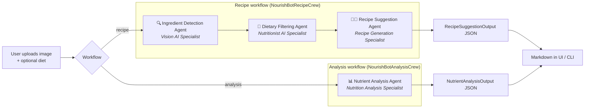

# 🥗 AI NourishBot: Multi-Agent, Multimodal Dietary Assistant

AI NourishBot is a nutrition assistant built from **collaborating AI agents** ([CrewAI](https://www.crewai.com/)) and **several foundation models on IBM watsonx.ai**. Upload a photo of a dish or of your fridge and it will either:

- **Analyze the meal**: estimate its calories, break down macro- and micronutrients, and evaluate how healthy it is, or
- **Suggest recipes**: detect the ingredients, remove the ones that break your diet (vegan, keto, gluten-free…), and propose recipes that use what's left.

It runs as a [Gradio](https://gradio.app/) web app, from the command line, or as a Python library.

---

## ✨ Features

| Feature | Description |
|---|---|
| **Ingredient detection** | A vision model lists the ingredients visible in the uploaded image. |
| **Dietary filtering** | An LLM removes ingredients that don't fit your restriction (vegan, vegetarian, gluten-free, keto…). |
| **Recipe suggestion** | A "chef" agent writes recipes (title, ingredients, instructions, calories) from the filtered ingredients. |
| **Calorie estimation** | Per-item portion sizes and calories, plus the total. |
| **Nutrient analysis** | Protein, carbohydrates, fats, vitamins (%DV) and minerals. |
| **Health evaluation** | A short summary of how healthy the meal is. |
| **Structured output** | Results are validated against Pydantic schemas and rendered as Markdown tables. |

---

## 🧠 How It Works

NourishBot is a **multi-agent system (MAS)**: each agent has a role, a goal, a backstory and its own tools, and a **crew** runs the agents' tasks one after another (`Process.sequential`). There are two crews, one per workflow:



**Recipe workflow:** detect ingredients → filter for the diet → suggest recipes.
**Analysis workflow:** the multimodal model can read the dish directly, so a single agent produces calories, nutrients and a health evaluation.

### Layered architecture

Each layer only depends on the layers below it, so you can swap the UI, a model or a crew without touching the rest:

```
┌─────────────────────────────────────────────────────────────┐
│ Front-ends     app.py · nourishbot/ui/ · nourishbot/cli.py  │
├─────────────────────────────────────────────────────────────┤
│ Orchestration  nourishbot/workflows.py  (crew → kickoff →   │
│                format) · nourishbot/formatting.py           │
├─────────────────────────────────────────────────────────────┤
│ Agents         nourishbot/crews/  (+ config/agents.yaml,    │
│                config/tasks.yaml) · nourishbot/schemas.py   │
├─────────────────────────────────────────────────────────────┤
│ Tools          nourishbot/tools/  (LangChain @tool wrappers)│
├─────────────────────────────────────────────────────────────┤
│ Services       nourishbot/services/food_ai.py · prompts.py  │
│                nourishbot/services/watsonx_client.py        │
├─────────────────────────────────────────────────────────────┤
│ Foundation     settings.py (env config) · utils/ (images,   │
│                text parsing)                                │
└─────────────────────────────────────────────────────────────┘
```

---

## 🤖 Models Used

NourishBot uses **several models**, each picked for its job:

| Where | Default model | Purpose | Override with |
|---|---|---|---|
| Vision tools (ingredient extraction, nutrient analysis) | `meta-llama/llama-3-2-90b-vision-instruct` on watsonx.ai | Reads the food image | `NOURISHBOT_VISION_MODEL` |
| Dietary filter tool | `ibm/granite-4-h-small` on watsonx.ai | Text reasoning over ingredient lists | `NOURISHBOT_TEXT_MODEL` |
| Agent reasoning (CrewAI) | CrewAI's default LLM | Lets each agent plan, call its tools and write its final answer | `NOURISHBOT_AGENT_LLM` |

> **Note:** The latest revision of the lab guide uses `meta-llama/llama-4-maverick-17b-128e-instruct-fp8` as the vision model. If watsonx.ai reports that the Llama 3.2 Vision model is unavailable in your region, run:
> `export NOURISHBOT_VISION_MODEL=meta-llama/llama-4-maverick-17b-128e-instruct-fp8`

---

## 📁 Project Structure

```
NourishBot/
├── app.py                        # Web app entry point (python app.py → port 5000)
├── nourishbot/                   # Application package
│   ├── __init__.py
│   ├── __main__.py               # Enables `python -m nourishbot`
│   ├── cli.py                    # Command-line interface
│   ├── settings.py               # All configuration (env vars / .env, defaults)
│   ├── prompts.py                # Prompt templates sent to the models
│   ├── schemas.py                # Pydantic output models (recipes, nutrient analysis)
│   ├── formatting.py             # Workflow output → Markdown
│   ├── workflows.py              # WorkflowType + run_workflow(): shared by UI and CLI
│   ├── services/
│   │   ├── watsonx_client.py     # Lazy watsonx.ai credentials, cached models, chat()
│   │   └── food_ai.py            # extract / clean / diet-filter / analyze logic
│   ├── tools/
│   │   ├── ingredient_tools.py   # "Extract ingredients", "Filter ingredients"
│   │   ├── dietary_tools.py      # "Filter based on dietary restrictions"
│   │   └── nutrition_tools.py    # "Analyze nutritional values and calories…"
│   ├── crews/
│   │   ├── base.py               # BaseNourishBotCrew: all agents & tasks
│   │   ├── recipe_crew.py        # NourishBotRecipeCrew (3 agents)
│   │   ├── analysis_crew.py      # NourishBotAnalysisCrew (1 agent)
│   │   └── config/
│   │       ├── agents.yaml       # Roles, goals, backstories
│   │       └── tasks.yaml        # Task descriptions & expected outputs
│   ├── ui/
│   │   ├── interface.py          # build_demo() + analyze_food() callback
│   │   └── assets.py             # CSS, JS banner, instructions, examples
│   └── utils/
│       ├── images.py             # Load path/URL, base64 data URIs, temp saving
│       └── text.py               # Comma-separated list parsing
├── examples/                     # Sample images (food-1.jpg … food-4.jpg)
├── tests/                        # pytest suite (runs offline, no API calls)
├── requirements.txt              # Pinned dependencies (from the lab)
├── .env.example                  # Template for credentials & overrides
└── README.md
```

---

## 🧩 Components

### Agents (`nourishbot/crews/config/agents.yaml`, wired in `crews/base.py`)

| Agent | Role | Tools | Workflow | Notes |
|---|---|---|---|---|
| `ingredient_detection_agent` | Vision AI Specialist | Extract ingredients, Filter ingredients | Recipe | `max_iter=5`, no delegation |
| `dietary_filtering_agent` | Nutritionist AI Specialist | Filter based on dietary restrictions | Recipe | `max_iter=6`, delegation allowed; filters only once |
| `recipe_suggestion_agent` | Recipe Generation Specialist | none (pure LLM) | Recipe | Goal uses `{dietary_restrictions}` |
| `nutrient_analysis_agent` | Nutrition Analysis Specialist | Analyze nutritional values… | Analysis | `max_iter=4`, no delegation |

### Tasks (`nourishbot/crews/config/tasks.yaml`)

| Task | Agent | Input | Output |
|---|---|---|---|
| `ingredient_detection_task` | ingredient_detection_agent | `{uploaded_image}` | List of ingredients |
| `dietary_filtering_task` | dietary_filtering_agent | previous task output + `{dietary_restrictions}` | Filtered ingredient list |
| `recipe_suggestion_task` | recipe_suggestion_agent | outputs of the previous tasks | `RecipeSuggestionOutput` (JSON) |
| `nutrient_analysis_task` | nutrient_analysis_agent | `{uploaded_image}` | `NutrientAnalysisOutput` (JSON) |

### Tools (`nourishbot/tools/`) → Services (`nourishbot/services/food_ai.py`)

Tools are thin LangChain `@tool` wrappers (their names and docstrings are what agents see). The logic lives in plain functions, so you can call it without CrewAI:

| Tool name (seen by agents) | Service function | Model |
|---|---|---|
| `Extract ingredients` | `extract_ingredients(image_input)` | Vision |
| `Filter ingredients` | `clean_ingredients(raw)` | none (string parsing) |
| `Filter based on dietary restrictions` | `filter_by_dietary_restrictions(ingredients, diet)` | Text (skipped when no diet is given) |
| `Analyze nutritional values and calories of the dish from uploaded image` | `analyze_nutrition(image_input)` | Vision |

`image_input` can be a **local path or an http(s) URL**.

### Output schemas (`nourishbot/schemas.py`)

- `RecipeSuggestionOutput` → `recipes: [Recipe(title, ingredients, instructions, calorie_estimate)]`
- `NutrientAnalysisOutput` → `dish, portion_size, estimated_calories, nutrients(protein, carbohydrates, fats, vitamins[], minerals[]), health_evaluation`

---

## 🚀 Usage

### 1. Web app

```bash
python app.py            # → http://127.0.0.1:5000
```

1. **Upload an image**: a fridge or ingredients for *recipe*, a finished dish for *analysis*.
2. *(Optional)* type a **dietary restriction**, e.g. `vegan`, `keto`, `gluten-free`.
3. Choose the **workflow**: `recipe` or `analysis`.
4. Click **Analyze**. The agents usually need **20-30 seconds**.

You can also click one of the four **examples** to fill in the inputs, then press **Analyze**.

### 2. Command line

```bash
python -m nourishbot examples/food-1.jpg recipe --diet vegan
python -m nourishbot examples/food-2.jpg analysis
python -m nourishbot https://example.com/meal.jpg analysis --json   # raw JSON
python -m nourishbot --help
```

### 3. Python API

```python
from nourishbot.workflows import run_workflow, run_workflow_markdown

markdown = run_workflow_markdown("examples/food-3.jpg", "recipe", dietary_restrictions="keto")
data = run_workflow("examples/food-4.jpg", "analysis")      # dict matching NutrientAnalysisOutput

# Single model calls, without agents:
from nourishbot.services import extract_ingredients, filter_by_dietary_restrictions
raw = extract_ingredients("examples/food-1.jpg")
```

## 🧪 Testing

```bash
pip install pytest        # already in requirements.txt
pytest -q
```

The 17 tests run **offline**: watsonx.ai calls are mocked, and the crew tests only check wiring (agents, tasks, tools, schemas) without calling any model.

---

## Credits & Attribution

**This code base originates from IBM Skills Network course material.** The refactor keeps the original design, agent and task definitions, prompts and UI.

- **Source lab:** *"Building your own AI Nutrition Coach using a Multi-Agent System and Multimodal AI"*, IBM Skills Network guided project (about 60 minutes), part of the **IBM RAG and Agentic AI Professional Certificate**.
- **Original repository:** published on GitHub under the [IBM Developer Skills Network](https://github.com/ibm-developer-skills-network) organization. The lab clones it and checks out the `5-final` branch for the finished app. An earlier public version of the project is [HaileyTQuach/Smart-Nutritional-App](https://github.com/HaileyTQuach/Smart-Nutritional-App).
- **Original author:** [Hailey Quach](https://www.haileyq.com/).
- **Other contributors to the lab:** [Ricky Shi](https://author.skills.network/instructors/ricky_shi), [Karan Goswami](https://author.skills.network/instructors/karan_goswami), [Wojciech "Victor" Fulmyk](https://www.linkedin.com/in/wfulmyk).
- **Prerequisite project:** [AI Calorie Coach: image-based nutrition guide with Llama 3.2](https://cognitiveclass.ai/courses/ai-calorie-coach-image-based-nutrition-guide-with-llama-3-2) (Flask predecessor of NourishBot).
- **Refactoring, modularization, tests and this README:** Felipe Cortes, completed as part of the certificate.

**Built with:** [CrewAI](https://docs.crewai.com/introduction) · [IBM watsonx.ai](https://www.ibm.com/watsonx) · [Meta Llama](https://huggingface.co/meta-llama) · [IBM Granite](https://www.ibm.com/granite) · [Gradio](https://gradio.app/) · [LangChain](https://www.langchain.com/) · [Pydantic](https://docs.pydantic.dev/)

### License

The lab content is licensed under the [Apache License 2.0](https://www.apache.org/licenses/LICENSE-2.0). The original project README states the MIT License. This derivative keeps the original authors' credits. If you publish it, include the license of the upstream repository you cloned and keep this attribution section.
