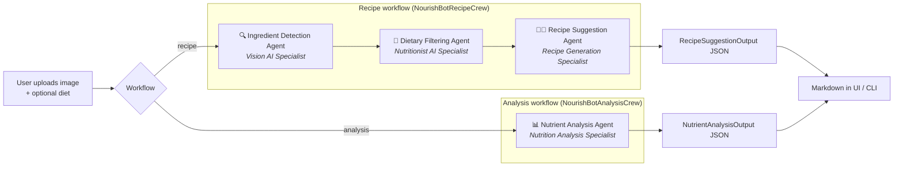

# 🥗 AI NourishBot: Multi-Agent, Multimodal Dietary Assistant

AI NourishBot is a nutrition assistant built from **collaborating AI agents** ([CrewAI](https://www.crewai.com/)) and **several foundation models on IBM watsonx.ai**. Upload a photo of a dish or of your fridge and it will either:

- **Analyze the meal**: estimate its calories, break down macro- and micronutrients, and evaluate how healthy it is, or
- **Suggest recipes**: detect the ingredients, remove the ones that break your diet (vegan, keto, gluten-free…), and propose recipes that use what's left.

It runs as a [Gradio](https://gradio.app/) web app, from the command line, or as a Python library.

> [!IMPORTANT]
> **Origin of this code.** This project is **not an original work**. It comes from the **IBM Skills Network** guided project **"Building your own AI Nutrition Coach using a Multi-Agent System and Multimodal AI"**, part of the **IBM RAG and Agentic AI Professional Certificate**. The original code base was written by the lab's authors and is published on GitHub by IBM Developer Skills Network. This repository **refactors and reorganizes that code** into a modular package and adds documentation, tests and a CLI. All credit for the original design, prompts, agents and application goes to the lab's authors. See [Credits & Attribution](#-credits--attribution).

---

## Table of Contents

1. [Features](#-features)
2. [How It Works](#-how-it-works)
3. [Models Used](#-models-used)
4. [Project Structure](#-project-structure)
5. [Components](#-components)
6. [Setup](#-setup)
7. [Usage](#-usage)
8. [Configuration](#-configuration)
9. [Testing](#-testing)
10. [What Changed in the Refactor](#-what-changed-in-the-refactor)
11. [Troubleshooting](#-troubleshooting)
12. [Disclaimer](#-disclaimer)
13. [Credits & Attribution](#-credits--attribution)

---

## ✨ Features

| Feature | Description |
|---|---|
| **Ingredient detection** | A vision model lists the ingredients visible in the uploaded image. |
| **Dietary filtering** | An LLM removes ingredients that don't fit your restriction (vegan, vegetarian, gluten-free, keto…). |
| **Recipe suggestion** | A "chef" agent writes recipes (title, ingredients, instructions, calories) from the filtered ingredients. |
| **Calorie estimation** | Per-item portion sizes and calories, plus the total. |
| **Nutrient analysis** | Protein, carbohydrates, fats, vitamins (%DV) and minerals. |
| **Health evaluation** | A short summary of how healthy the meal is. |
| **Structured output** | Results are validated against Pydantic schemas and rendered as Markdown tables. |

---

## 🧠 How It Works

NourishBot is a **multi-agent system (MAS)**: each agent has a role, a goal, a backstory and its own tools, and a **crew** runs the agents' tasks one after another (`Process.sequential`). There are two crews, one per workflow:



**Recipe workflow:** detect ingredients → filter for the diet → suggest recipes.
**Analysis workflow:** the multimodal model can read the dish directly, so a single agent produces calories, nutrients and a health evaluation.

### Layered architecture

Each layer only depends on the layers below it, so you can swap the UI, a model or a crew without touching the rest:

```
┌─────────────────────────────────────────────────────────────┐
│ Front-ends     app.py · nourishbot/ui/ · nourishbot/cli.py  │
├─────────────────────────────────────────────────────────────┤
│ Orchestration  nourishbot/workflows.py  (crew → kickoff →   │
│                format) · nourishbot/formatting.py           │
├─────────────────────────────────────────────────────────────┤
│ Agents         nourishbot/crews/  (+ config/agents.yaml,    │
│                config/tasks.yaml) · nourishbot/schemas.py   │
├─────────────────────────────────────────────────────────────┤
│ Tools          nourishbot/tools/  (LangChain @tool wrappers)│
├─────────────────────────────────────────────────────────────┤
│ Services       nourishbot/services/food_ai.py · prompts.py  │
│                nourishbot/services/watsonx_client.py        │
├─────────────────────────────────────────────────────────────┤
│ Foundation     settings.py (env config) · utils/ (images,   │
│                text parsing)                                │
└─────────────────────────────────────────────────────────────┘
```

---

## 🤖 Models Used

NourishBot uses **several models**, each picked for its job:

| Where | Default model | Purpose | Override with |
|---|---|---|---|
| Vision tools (ingredient extraction, nutrient analysis) | `meta-llama/llama-3-2-90b-vision-instruct` on watsonx.ai | Reads the food image | `NOURISHBOT_VISION_MODEL` |
| Dietary filter tool | `ibm/granite-4-h-small` on watsonx.ai | Text reasoning over ingredient lists | `NOURISHBOT_TEXT_MODEL` |
| Agent reasoning (CrewAI) | CrewAI's default LLM | Lets each agent plan, call its tools and write its final answer | `NOURISHBOT_AGENT_LLM` |

> **Note:** The latest revision of the lab guide uses `meta-llama/llama-4-maverick-17b-128e-instruct-fp8` as the vision model. If watsonx.ai reports that the Llama 3.2 Vision model is unavailable in your region, run:
> `export NOURISHBOT_VISION_MODEL=meta-llama/llama-4-maverick-17b-128e-instruct-fp8`

---

## 📁 Project Structure

```
NourishBot/
├── app.py                        # Web app entry point (python app.py → port 5000)
├── nourishbot/                   # Application package
│   ├── __init__.py
│   ├── __main__.py               # Enables `python -m nourishbot`
│   ├── cli.py                    # Command-line interface
│   ├── settings.py               # All configuration (env vars / .env, defaults)
│   ├── prompts.py                # Prompt templates sent to the models
│   ├── schemas.py                # Pydantic output models (recipes, nutrient analysis)
│   ├── formatting.py             # Workflow output → Markdown
│   ├── workflows.py              # WorkflowType + run_workflow(): shared by UI and CLI
│   ├── services/
│   │   ├── watsonx_client.py     # Lazy watsonx.ai credentials, cached models, chat()
│   │   └── food_ai.py            # extract / clean / diet-filter / analyze logic
│   ├── tools/
│   │   ├── ingredient_tools.py   # "Extract ingredients", "Filter ingredients"
│   │   ├── dietary_tools.py      # "Filter based on dietary restrictions"
│   │   └── nutrition_tools.py    # "Analyze nutritional values and calories…"
│   ├── crews/
│   │   ├── base.py               # BaseNourishBotCrew: all agents & tasks
│   │   ├── recipe_crew.py        # NourishBotRecipeCrew (3 agents)
│   │   ├── analysis_crew.py      # NourishBotAnalysisCrew (1 agent)
│   │   └── config/
│   │       ├── agents.yaml       # Roles, goals, backstories
│   │       └── tasks.yaml        # Task descriptions & expected outputs
│   ├── ui/
│   │   ├── interface.py          # build_demo() + analyze_food() callback
│   │   └── assets.py             # CSS, JS banner, instructions, examples
│   └── utils/
│       ├── images.py             # Load path/URL, base64 data URIs, temp saving
│       └── text.py               # Comma-separated list parsing
├── examples/                     # Sample images (food-1.jpg … food-4.jpg)
├── tests/                        # pytest suite (runs offline, no API calls)
├── requirements.txt              # Pinned dependencies (from the lab)
├── .env.example                  # Template for credentials & overrides
└── README.md
```

---

## 🧩 Components

### Agents (`nourishbot/crews/config/agents.yaml`, wired in `crews/base.py`)

| Agent | Role | Tools | Workflow | Notes |
|---|---|---|---|---|
| `ingredient_detection_agent` | Vision AI Specialist | Extract ingredients, Filter ingredients | Recipe | `max_iter=5`, no delegation |
| `dietary_filtering_agent` | Nutritionist AI Specialist | Filter based on dietary restrictions | Recipe | `max_iter=6`, delegation allowed; filters only once |
| `recipe_suggestion_agent` | Recipe Generation Specialist | none (pure LLM) | Recipe | Goal uses `{dietary_restrictions}` |
| `nutrient_analysis_agent` | Nutrition Analysis Specialist | Analyze nutritional values… | Analysis | `max_iter=4`, no delegation |

### Tasks (`nourishbot/crews/config/tasks.yaml`)

| Task | Agent | Input | Output |
|---|---|---|---|
| `ingredient_detection_task` | ingredient_detection_agent | `{uploaded_image}` | List of ingredients |
| `dietary_filtering_task` | dietary_filtering_agent | previous task output + `{dietary_restrictions}` | Filtered ingredient list |
| `recipe_suggestion_task` | recipe_suggestion_agent | outputs of the previous tasks | `RecipeSuggestionOutput` (JSON) |
| `nutrient_analysis_task` | nutrient_analysis_agent | `{uploaded_image}` | `NutrientAnalysisOutput` (JSON) |

### Tools (`nourishbot/tools/`) → Services (`nourishbot/services/food_ai.py`)

Tools are thin LangChain `@tool` wrappers (their names and docstrings are what agents see). The logic lives in plain functions, so you can call it without CrewAI:

| Tool name (seen by agents) | Service function | Model |
|---|---|---|
| `Extract ingredients` | `extract_ingredients(image_input)` | Vision |
| `Filter ingredients` | `clean_ingredients(raw)` | none (string parsing) |
| `Filter based on dietary restrictions` | `filter_by_dietary_restrictions(ingredients, diet)` | Text (skipped when no diet is given) |
| `Analyze nutritional values and calories of the dish from uploaded image` | `analyze_nutrition(image_input)` | Vision |

`image_input` can be a **local path or an http(s) URL**.

### Output schemas (`nourishbot/schemas.py`)

- `RecipeSuggestionOutput` → `recipes: [Recipe(title, ingredients, instructions, calorie_estimate)]`
- `NutrientAnalysisOutput` → `dish, portion_size, estimated_calories, nutrients(protein, carbohydrates, fats, vitamins[], minerals[]), health_evaluation`

---

## ⚙️ Setup

### Prerequisites

- **Python 3.10 to 3.12** (3.11 recommended, as in the lab). CrewAI 0.75 does not install on Python 3.13.
- Access to **IBM watsonx.ai** (automatic inside the IBM Skills Network Cloud IDE).
- An LLM for the CrewAI agents: CrewAI's default (OpenAI, set `OPENAI_API_KEY`) or any LiteLLM model through `NOURISHBOT_AGENT_LLM`. The Skills Network lab environment already provides this.

### Option A: IBM Skills Network Cloud IDE (the lab)

```bash
cd /home/project/NourishBot          # copy or clone this repo here
python3.11 -m venv venv
source venv/bin/activate
pip install -r requirements.txt      # takes about 3-5 minutes
python app.py
```

Then click **Web Application** (port **5000**). No API keys are needed: the lab injects watsonx.ai credentials and the project id defaults to `skills-network`.

### Option B: Local machine

```bash
git clone <your-repo-url> NourishBot && cd NourishBot
python3.11 -m venv venv
source venv/bin/activate              # Windows: venv\Scripts\activate
pip install -r requirements.txt
cp .env.example .env                  # then edit .env
```

Minimum `.env` outside the lab:

```dotenv
WATSONX_URL=https://us-south.ml.cloud.ibm.com
WATSONX_API_KEY=<your IBM Cloud API key>
WATSONX_PROJECT_ID=<your watsonx.ai project id>

# Agent reasoning LLM, pick one:
OPENAI_API_KEY=<key>                                        # CrewAI default
# NOURISHBOT_AGENT_LLM=watsonx/meta-llama/llama-3-3-70b-instruct
# WATSONX_APIKEY=<same IBM Cloud API key>   # LiteLLM's variable name for watsonx
```

---

## 🚀 Usage

### 1. Web app

```bash
python app.py            # → http://127.0.0.1:5000
```

1. **Upload an image**: a fridge or ingredients for *recipe*, a finished dish for *analysis*.
2. *(Optional)* type a **dietary restriction**, e.g. `vegan`, `keto`, `gluten-free`.
3. Choose the **workflow**: `recipe` or `analysis`.
4. Click **Analyze**. The agents usually need **20-30 seconds**.

You can also click one of the four **examples** to fill in the inputs, then press **Analyze**.

### 2. Command line

```bash
python -m nourishbot examples/food-1.jpg recipe --diet vegan
python -m nourishbot examples/food-2.jpg analysis
python -m nourishbot https://example.com/meal.jpg analysis --json   # raw JSON
python -m nourishbot --help
```

### 3. Python API

```python
from nourishbot.workflows import run_workflow, run_workflow_markdown

markdown = run_workflow_markdown("examples/food-3.jpg", "recipe", dietary_restrictions="keto")
data = run_workflow("examples/food-4.jpg", "analysis")      # dict matching NutrientAnalysisOutput

# Single model calls, without agents:
from nourishbot.services import extract_ingredients, filter_by_dietary_restrictions
raw = extract_ingredients("examples/food-1.jpg")
```

### Extending

- **Change an agent's persona or a task's instructions:** edit the YAML files in `nourishbot/crews/config/`.
- **Add a tool:** write the logic in `services/`, wrap it with `@tool` in `tools/`, then add it to an agent in `crews/base.py`.
- **Add a workflow:** create a crew in `crews/`, add a `WorkflowType` value and a formatter in `workflows.py`, and the UI radio button and CLI pick it up automatically.

---

## 🔧 Configuration

All settings live in `nourishbot/settings.py` and can be overridden with environment variables or a `.env` file:

| Variable | Default | Description |
|---|---|---|
| `WATSONX_URL` | `https://us-south.ml.cloud.ibm.com` | watsonx.ai endpoint |
| `WATSONX_API_KEY` | *(none: lab-injected)* | IBM Cloud API key |
| `WATSONX_PROJECT_ID` | `skills-network` | watsonx.ai project id |
| `NOURISHBOT_VISION_MODEL` | `meta-llama/llama-3-2-90b-vision-instruct` | Vision model for image tools |
| `NOURISHBOT_TEXT_MODEL` | `ibm/granite-4-h-small` | Text model for dietary filtering |
| `NOURISHBOT_VISION_MAX_TOKENS` | `300` | Max tokens for vision replies |
| `NOURISHBOT_TEXT_MAX_TOKENS` | `150` | Max tokens for the diet filter |
| `NOURISHBOT_AGENT_LLM` | *(CrewAI default)* | LiteLLM model string for agent reasoning |
| `NOURISHBOT_IMAGE_TIMEOUT` | `30` | Seconds to wait when downloading image URLs |
| `NOURISHBOT_HOST` | `127.0.0.1` | Web server host (`0.0.0.0` for Docker/remote) |
| `NOURISHBOT_PORT` | `5000` | Web server port |

---

## 🧪 Testing

```bash
pip install pytest        # already in requirements.txt
pytest -q
```

The 17 tests run **offline**: watsonx.ai calls are mocked, and the crew tests only check wiring (agents, tasks, tools, schemas) without calling any model.

---

## 🔄 What Changed in the Refactor

Functionally the app behaves like the lab's final version. A side-by-side check confirmed that the agents (roles, goals, backstories, tools, iteration limits), task definitions, output schemas, prompts and Markdown formatters are **identical** to the original. The changes are structural, plus a few robustness fixes:

| Original (`5-final` lab code) | Refactored |
|---|---|
| `src/tools.py`: four tools, each repeating image loading, base64 encoding and model setup | `utils/images.py` + `services/watsonx_client.py` + `services/food_ai.py`; tools are about 5 lines each |
| watsonx `Credentials`/`APIClient` created at import time in **two** modules (`tools.py`, `crew.py`) | One lazy, cached client in `services/watsonx_client.py`; the unused `APIClient` was removed |
| Hard-coded URL, project id and model ids | `settings.py` with env-var / `.env` overrides; defaults unchanged |
| Prompts embedded inside tool functions | `prompts.py` (text kept verbatim) |
| `src/crew.py`: base class + both crews in one file | `crews/base.py`, `crews/recipe_crew.py`, `crews/analysis_crew.py` |
| Tasks received `depends_on=` / `input_data=` arguments | Removed: CrewAI 0.75 silently ignores them (verified). Data already flows between tasks through `Process.sequential`, so behaviour is unchanged |
| `app.py`: UI, CSS/JS, formatters and orchestration in one 240-line file | `ui/interface.py`, `ui/assets.py`, `formatting.py`, `workflows.py`; `app.py` is about 20 lines |
| Uploads always saved to `./uploaded_image.jpg` (concurrent users overwrite each other; PNGs with transparency crash) | Unique temp file per request, converted to RGB, deleted afterwards |
| No input validation; errors leave a blank panel | Friendly `gr.Error` messages for a missing image or workflow, or a failed run |
| `requests.get` without a timeout | Configurable timeout |
| Example paths relative to the working directory | Absolute paths from the package location |
| README described a `main.py` CLI that didn't exist | Working CLI: `python -m nourishbot` |
| No tests | `tests/` (formatting, utils, services with mocks, crew wiring) |

---

## 🩺 Troubleshooting

| Problem | Fix |
|---|---|
| `ModuleNotFoundError: nourishbot` | Run commands from the project root (the folder that contains `app.py`). |
| Page doesn't load in the Cloud IDE | Make sure `python app.py` is still running and you opened port **5000**. |
| watsonx.ai says the model is not supported or deprecated | Set `NOURISHBOT_VISION_MODEL` / `NOURISHBOT_TEXT_MODEL` to a model available in your region (see [Models Used](#-models-used)). |
| `OPENAI_API_KEY` / auth error from the agents | Set `OPENAI_API_KEY`, or set `NOURISHBOT_AGENT_LLM` to another LiteLLM provider. |
| `pip` can't install `crewai==0.75.0` | Use Python 3.10-3.12. |
| `No matching distribution found for litellm==1.50.2` | Some package indexes no longer serve that release. Change the pin in `requirements.txt` to `litellm==1.53.1`; the app and tests were verified with it. |
| Console shows telemetry or connection errors from `opentelemetry` | These come from CrewAI's anonymous telemetry and are harmless. Silence them with `export OTEL_SDK_DISABLED=true`. |
| The app fails occasionally | LLM output varies from run to run. Refresh and try again, as the lab suggests. |

Stop the server with `Ctrl+C`.

---

## ⚠️ Disclaimer

The recipes and nutritional information are generated automatically from image analysis. They are **approximate** and may not account for every dietary restriction, allergen or unsafe ingredient. Always review suggestions before preparing or eating food, and consult a qualified nutritionist or healthcare provider for personal dietary or medical advice. The output is guidance, **not** a medical or dietary prescription.

---

## 🙏 Credits & Attribution

**This code base originates from IBM Skills Network course material.** The refactor keeps the original design, agent and task definitions, prompts and UI.

- **Source lab:** *"Building your own AI Nutrition Coach using a Multi-Agent System and Multimodal AI"*, IBM Skills Network guided project (about 60 minutes), part of the **IBM RAG and Agentic AI Professional Certificate**.
- **Original repository:** published on GitHub under the [IBM Developer Skills Network](https://github.com/ibm-developer-skills-network) organization. The lab clones it and checks out the `5-final` branch for the finished app. An earlier public version of the project is [HaileyTQuach/Smart-Nutritional-App](https://github.com/HaileyTQuach/Smart-Nutritional-App).
- **Original author:** [Hailey Quach](https://www.haileyq.com/).
- **Other contributors to the lab:** [Ricky Shi](https://author.skills.network/instructors/ricky_shi), [Karan Goswami](https://author.skills.network/instructors/karan_goswami), [Wojciech "Victor" Fulmyk](https://www.linkedin.com/in/wfulmyk).
- **Prerequisite project:** [AI Calorie Coach: image-based nutrition guide with Llama 3.2](https://cognitiveclass.ai/courses/ai-calorie-coach-image-based-nutrition-guide-with-llama-3-2) (Flask predecessor of NourishBot).
- **Refactoring, modularization, tests and this README:** Felipe Cortes, completed as part of the certificate.

**Built with:** [CrewAI](https://docs.crewai.com/introduction) · [IBM watsonx.ai](https://www.ibm.com/watsonx) · [Meta Llama](https://huggingface.co/meta-llama) · [IBM Granite](https://www.ibm.com/granite) · [Gradio](https://gradio.app/) · [LangChain](https://www.langchain.com/) · [Pydantic](https://docs.pydantic.dev/)

### License

The lab content is licensed under the [Apache License 2.0](https://www.apache.org/licenses/LICENSE-2.0). The original project README states the MIT License. This derivative keeps the original authors' credits. If you publish it, include the license of the upstream repository you cloned and keep this attribution section.
